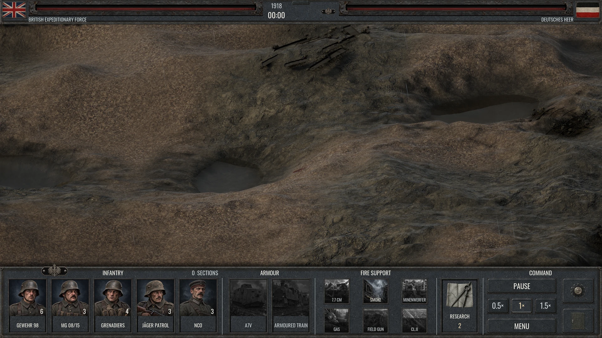

<!-- Generated by tools/render_release_docs.py; edit release/current.json. -->

# Warfare Front

[简体中文](README.zh-CN.md)

A First World War trench strategy game for Windows. Lead infantry and armour, coordinate artillery and air support, and fight for ground and morale across British and German campaigns.



Actual V86 Shipping capture from a focused validation scene, not a large-scale battle or evidence of a full campaign playthrough. [View the screenshot gallery](docs/media/README.md) for research and report screens; the report uses synthetic review data to check layout, not natural campaign results.

## About this repository

This is the game's release and support repository. The game source is not published here. GitHub's automatic **Source code** ZIP and TAR archives contain repository files, not the playable game.

[Get the latest Windows release](https://github.com/ShoWTimETheKey/Warfare-Front/releases/latest) · [Version history](CHANGELOG.md) · [Report a problem](https://github.com/ShoWTimETheKey/Warfare-Front/issues/new/choose)

## Install and play — V86

1. Open the [latest release page](https://github.com/ShoWTimETheKey/Warfare-Front/releases/latest) and download the **Setup.exe** asset for that release. The current installer is `Warfare-Front-v86-Setup.exe`.
2. Read the unsigned-installer notice below and verify its SHA-256 before running it. Choose an installation folder and optional desktop shortcut. Setup downloads the matching data and checks each file.
3. Open **Start → Warfare Front → Play**.

Setup installs for your current Windows account, adds Start menu entries and registers an uninstaller. Normal installation and play do not require administrator rights. Once installed, gameplay works offline. No earlier release, Epic Games Launcher, Unreal Editor, game account or archive tool is required.

For an offline installation, download the installer and **all 8 matching numbered data files** listed in this release's `START-HERE.txt`. Keep them together with their original filenames, then run Setup. Do not mix versions.

## Unsigned installer and file verification

The V86 installer is **not digitally signed**. Microsoft Defender SmartScreen may display “Windows protected your PC” or identify an unknown publisher. Keep Windows security protection enabled. If you are uncertain about the file or its origin, do not run it.

Download only from the [official repository release page](https://github.com/ShoWTimETheKey/Warfare-Front/releases/tag/v86). In PowerShell, from the folder containing the installer, inspect its checksum without running the file:

```powershell
Get-FileHash -LiteralPath '.\Warfare-Front-v86-Setup.exe' -Algorithm SHA256 | Format-List Algorithm,Hash,Path
```

Expected installer SHA-256:

```text
69e7543c6359bc7874fb3666c176850d2c8f736ca24165f30b584a446619b6dc
```

`SHA256SUMS.txt` also lists the data-file checksums. A matching hash detects corruption or a mismatch against the published value. A checksum hosted beside its download is **not independent proof of publisher identity**: an attacker able to replace both could change both. No code-signing or independent authenticity guarantee is claimed.

## Download size and free disk space

Sizes below use decimal GB (1 GB = 1,000,000,000 bytes). V86's 8 data volumes total **13.94 GB**; the installed payload is approximately **14.97 GB**. The installer is a separate small download.

For a first installation with downloads and the game on the same drive, **reserve at least 35 GB** as a conservative recommendation. **28.91 GB** is the arithmetic sum of the downloaded volumes and installed payload; it is **not a measured peak for every installation scenario**. Temporary files, copied offline volumes, existing installations kept during updates and backups can require more. Check free space on both the download/temp drive and destination drive.

The current release distributes full data volumes; no incremental patch or content-block updater is provided. Installing a newer release can require downloading its full matching data set.

## Campaigns and language

Britain and Germany are playable. France and Russia remain **Not yet available / 暂未开放** in the four-army selector; their campaigns are closed. Existing player records are retained.

English is the default interface language. Choose **简体中文** in Settings to switch to Simplified Chinese. Primary battlefield console labels remain English in either language.

## Windows and graphics compatibility

Use **Windows 10 22H2 x64 (build 19045), fully updated, or Windows 11 x64**, with a current hardware graphics driver. Normal launch uses DirectX 12. This is not a native macOS, Linux or ARM64 build. Windows N may require Microsoft's Media Feature Pack.

A measured minimum CPU, RAM capacity and GPU performance specification has **not been established**. The Low Spec launch is a fallback, not a claim that every integrated GPU can run the game acceptably. Performance depends on the hardware, resolution and driver.

**Low Spec** uses DirectX 11, Low quality and a 720p SDR window; it requires a working hardware DirectX 11 driver. **Safe Mode** uses DirectX 12 and a 1080p SDR window. Both disable NVIDIA features for that launch and preserve campaign progress and normal display preferences. Close the game before using either Start menu entry.

DLSS, Ray Reconstruction and Frame Generation require compatible NVIDIA hardware and drivers. HDR requires a supported display with Windows HDR enabled. Settings include display mode, resolution, frame cap, three graphics presets, audio and HDR calibration.

If the taskbar remains visible after fullscreen launch, activate the game window.

## Updates and older releases

Install a newer release with its matching Setup. The in-game update check opens the latest release page; it does not download or install updates. Keep your personal save folders when removing an older portable copy.

Older releases are retained for reference in [CHANGELOG.md](https://github.com/ShoWTimETheKey/Warfare-Front/blob/main/CHANGELOG.md). For normal installation, use the [latest release](https://github.com/ShoWTimETheKey/Warfare-Front/releases/latest); historical tags have not been renamed.

## Saves and uninstalling

Saves and preferences are outside the installation folder:

- British/German campaign records: `%LOCALAPPDATA%\Warfare1917\`
- Achievements and account records: `%LOCALAPPDATA%\WarfareFront\Account\`
- Retained national campaign records: `%LOCALAPPDATA%\WarfareFront\Campaigns\`
- Preferences and diagnostics: `%LOCALAPPDATA%\WarfareFront\Saved\`

`Warfare1917` is a legacy folder name retained for compatibility. Do not rename or move it to match the game's title. Uninstalling preserves saves and preferences.

## Report a problem

[Open an issue](https://github.com/ShoWTimETheKey/Warfare-Front/issues/new/choose) with the game version, Windows version, GPU and driver, launch mode, steps to reproduce and a screenshot if possible. State whether the problem happens in normal launch, Low Spec or Safe Mode.

Relevant diagnostic logs are under `%LOCALAPPDATA%\WarfareFront\Saved\` (usually its `Logs` subfolder). Share only the relevant log files, with personal names and absolute user paths redacted. Do not attach entire `Account`, `Campaigns` or save folders.

## Review scope and known limits

Focused checks passed for blood lifetime, campaign-report data and storage boundaries, and report navigation in an isolated test profile. These targeted checks do not represent a complete natural campaign playthrough. They do not certify every map, balance situation, GPU, driver, display, HDR mode or Frame Generation configuration.

## Release and installed files

The GitHub release supplies `START-HERE.txt`, `ReleaseNotes.md`, `README-INSTALLED.txt`, `DOWNLOADS.json` and `SHA256SUMS.txt`, alongside Setup and the data volumes. The installed game includes `README-INSTALLED.txt`, **`ReleaseNotes.txt`**, `GAME-LICENSE.txt`, `THIRD-PARTY-NOTICES.md` and `Licenses`.

The installed `ReleaseNotes.txt` is deliberately copied from the release attachment `ReleaseNotes.md`; this is a filename mapping, not a missing document.

## Credits and terms

Warfare Front is an independent historical game, not an official Armor Games release. Archival-style illustrations are generated reconstructions, not authentic historical photographs. The game depicts war violence and blood.

Consult the [game licence](https://github.com/ShoWTimETheKey/Warfare-Front/blob/main/LICENSE), `THIRD-PARTY-NOTICES.md` and the bundled component licences before redistributing the complete release. The installed game includes the licence as `GAME-LICENSE.txt`. Source code is not published or offered under an open-source licence.
