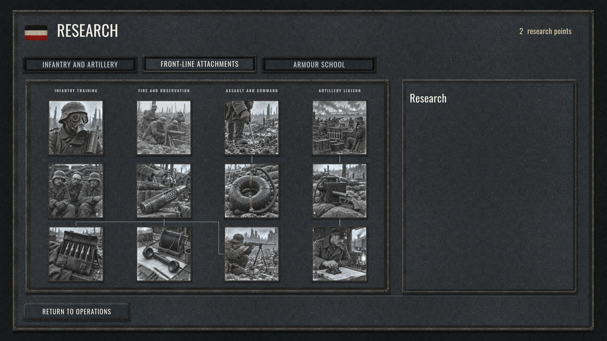
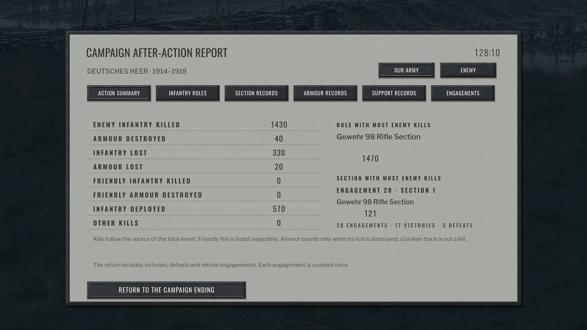

# V86 screenshots

These are actual V86 Shipping renderer captures from 11 October 2026, not
generated concept art. The web copies are resized proportionally and encoded as
WebP; the scene, lighting, colours and interface have not been retouched.
Source capture hashes and dimensions are recorded in [provenance.json](provenance.json).

## Battlefield interface

The battlefield during a focused blood-lifetime validation scene. This is not a
claim of a full natural campaign playthrough or a staged large-scale battle.

## Research

## Campaign report

The report below uses synthetic review data to check the report layout. It is
not a record of a player's natural campaign results.

